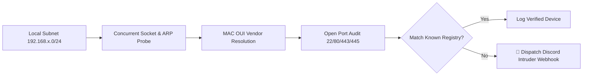

# 🖧 LAN-Sentry

<div align="center">

```
  ██╗      █████╗ ███╗   ██╗     ███████╗███████╗███╗   ██╗████████╗██████╗ ██╗   ██╗
  ██║     ██╔══██╗████╗  ██║     ██╔════╝██╔════╝████╗  ██║╚══██╔══╝██╔══██╗╚██╗ ██╔╝
  ██║     ███████║██╔██╗ ██║     ███████╗█████╗  ██╔██╗ ██║   ██║   ██████╔╝ ╚████╔╝ 
  ██║     ██╔══██║██║╚██╗██║     ╚════██║██╔══╝  ██║╚██╗██║   ██║   ██╔══██╗  ╚██╔╝  
  ███████╗██║  ██║██║ ╚████║     ███████║███████╗██║ ╚████║   ██║   ██║  ██║   ██║   
  ╚══════╝╚═╝  ╚═╝╚═╝  ╚═══╝     ╚══════╝╚══════╝╚═╝  ╚═══╝   ╚═╝   ╚═╝  ╚═╝   ╚═╝   
```

**High-Speed Local Subnet Sniffer · Port Auditor · Intruder Detection Discord Webhooks**

[](https://www.python.org/downloads/)
[](https://opensource.org/licenses/MIT)
[](https://github.com/psf/black)
[]()

</div>

---

## ⚡ Overview

**LAN-Sentry** is a lightweight, asynchronous network security monitor and intruder alerting daemon built in pure Python. It conducts lightning-fast subnet host discovery, inspects local ARP caches, resolves hardware OUI manufacturers, audits exposed service ports, and sounds the alarm whenever an unauthorized foreign device enters your local Wi-Fi or LAN.

---

## ✨ Features

- ⚡ **Multi-Threaded Subnet Discovery**: Audits an entire `/24` subnet (254 host addresses) in 1–2 seconds via non-blocking socket probes and concurrent thread pools.
- 🏷️ **Hardware OUI Vendor Recognition**: Built-in offline database automatically maps MAC prefixes to manufacturers (Apple, Raspberry Pi, Espressif IoT, Samsung, Sony, Ubiquiti, etc.).
- 🔍 **Common Port Vulnerability Probe**: Audits exposed TCP services (SSH `22`, HTTP `80`, HTTPS `443`, SMB `445`, RDP `3389`, Web `8080`).
- 🚨 **Real-Time Intruder Alerting**: Maintains an authorized hardware list (`known_devices.json`). Unrecognized MACs instantly trigger a Discord Webhook rich embed card with device specs.
- 📊 **Terminal Dashboard**: Clean interactive CLI tables powered by `rich` detailing IP, MAC, Vendor, Hostname, Open Ports, and Latency.

---

## 🚀 Installation & Setup

```bash
# Clone the repository
git clone https://github.com/loveslaw/LAN-Sentry.git
cd LAN-Sentry

# Install dependencies
pip install -r requirements.txt
```

---

## 📖 CLI Usage

### 1. Instant Network Scan
Discover all live hosts on the current local subnet:
```bash
python main.py scan
```
Or target a specific subnet range:
```bash
python main.py scan --subnet 192.168.0 --start 1 --end 100
```

### 2. Continuous Intruder Watcher Daemon
Monitor your LAN in the background and dispatch alerts:
```bash
python main.py watch --interval 30 --webhook "https://discord.com/api/webhooks/..."
```

### 3. Whitelist / Authorize Known Devices
Add trusted devices by MAC or IP:
```bash
python main.py authorize 00:1A:2B:3C:4D:5E --label "Developer Workstation"
python main.py authorize 192.168.1.1 --label "Default Gateway Router"
```

### 4. Review Authorized Registry
```bash
python main.py list-authorized
```

---

## 🏗️ Architecture



---

## 🧪 Testing

Run the automated test suite verifying IP resolution, OUI parsing, and intruder filtering:
```bash
python -m pytest tests/ -v
```

---

## 📜 License

Distributed under the [MIT License](LICENSE).
Author: **loveslaw**
